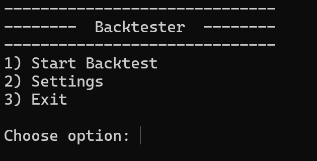
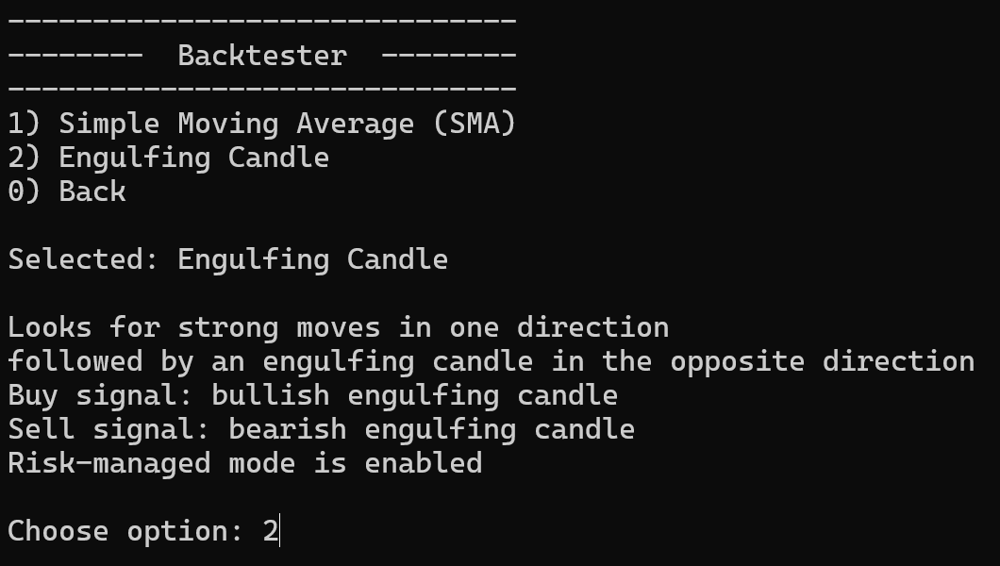
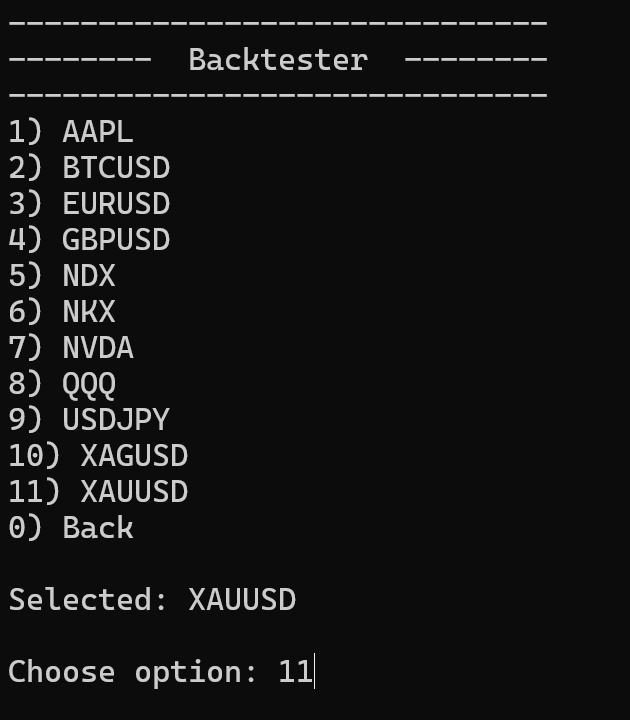
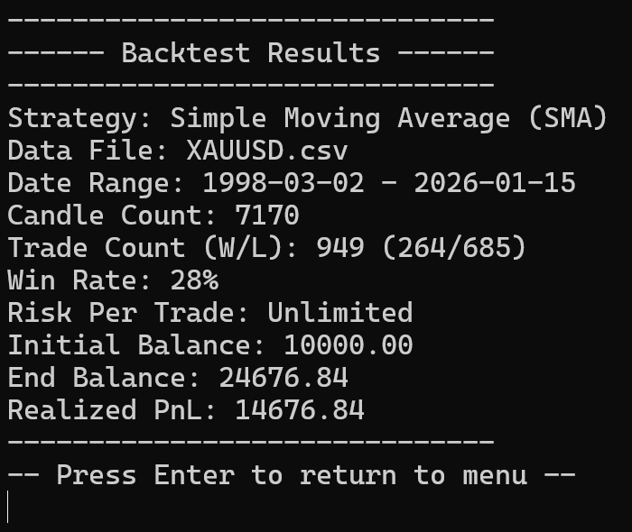

# Backtester

A C++17 CLI simulation engine for testing rule-based trading strategies against historical OHLC data. Built around a clean separation between data ingestion, strategy logic, position lifecycle, and balance accounting. The project aims to grow into a trading strategy research platform for developing, testing, comparing and analyzing strategies.

---









---

## Architecture

**Simulation loop** - `Backtester::run()` iterates candles, calls `strategy_->onCandle()` to get a signal and optional stop-loss, then passes both to `positionManager_.onCandle()`. The loop itself contains no strategy logic and no position logic.

**Strategy interface** - `onCandle(candle, stopLoss)` returns a `Signal` and optionally sets a stop-loss by reference.

**Data layer** - `DataManager` handles CSV ingestion, OHLC parsing, and data directory resolution. It has no coupling to strategy or position logic.

**Position and wallet** - `Wallet` is encapsulated inside `PositionManager`. Position lifecycle (open, close, direction, stop/target) and balance accounting are separated internally, which is reflected in the test coverage - each is tested independently via snapshots.

---

## Risk Model

Two execution modes are supported, determined per strategy:

**Price-change mode** - no stop-loss or position sizing. PnL is calculated as the percentage price change from open to close price. Used by SMA.

**Risk-managed mode** - the strategy sets a stop-loss; `PositionManager` derives the profit target from `risk / riskReward`. PnL is applied as a fixed percentage of wallet balance (`riskPerTrade`), win or loss. Used by Engulfing.

---

## Strategies

### Simple Moving Average (SMA)

14-period SMA. Long on close above SMA, short on close below. No position sizing - full balance per trade.

### Engulfing Candle

Looks for a sequence of same-direction candles followed by an engulfing candle in the opposite direction. Risk-managed sizing enabled.

---

## Build

```
cmake -S . -B build
cmake --build build
```

**Requirements**

* CMake >= 3.15
* C++17 compiler
* Terminal with ANSI escape code support

---

## Run

```
./build/backtester [<path/to/data-dir>]
```

If no path is provided, the engine tries `./data`, then `../data`. Data files must be CSV with the format `Date,Open,High,Low,Close`.

## Testing

Unit tests cover `DataManager`, `PositionManager`, and `Wallet` - the stateful components where bugs compound across a simulation run.

```
cmake --build build --target unit_tests
./build/unit_tests
```

---

## Roadmap

The milestones below outline the development of the trading strategy research platform.

### 1. Multi-asset portfolio backtesting

Load and align historical data for multiple instruments, then simulate positions in them simultaneously within one shared account. Track capital allocation and combined portfolio performance and risk.

### 2. Reusable indicators

Provide a consistent set of technical indicators that built-in strategies, user-defined strategies, and the visual strategy builder can all use.

### 3. Research interface

Evolve the terminal menu into an application for setting up experiments and exploring results. Present results visually with equity curves and trade timelines, while keeping a command-line interface for users who want to automate or script their research.

### 4. Built-in strategy configuration

Let users select and configure strategy parameters without changing the code. This makes it practical to explore different strategy setups on the same market data.

### 5. Visual strategy builder

Let users create strategies in the application by combining indicators and trading rules, without writing code. Strategies built this way should run through the same backtesting and evaluation workflow as other strategies.

### 6. User-defined strategies

Define a documented strategy API and a supported way to load custom strategies that use the same data, simulation, and reporting capabilities as built-in strategies without requiring changes to the core application.

### 7. Experiment comparison

Enable users to run different strategies and configurations under the same conditions, then compare their results and benchmarks to understand performance and risk trade-offs.

### 8. Parameter optimization and robustness testing

Automate strategy fine-tuning by testing different parameter combinations and evaluating how consistently they perform across historical periods.
